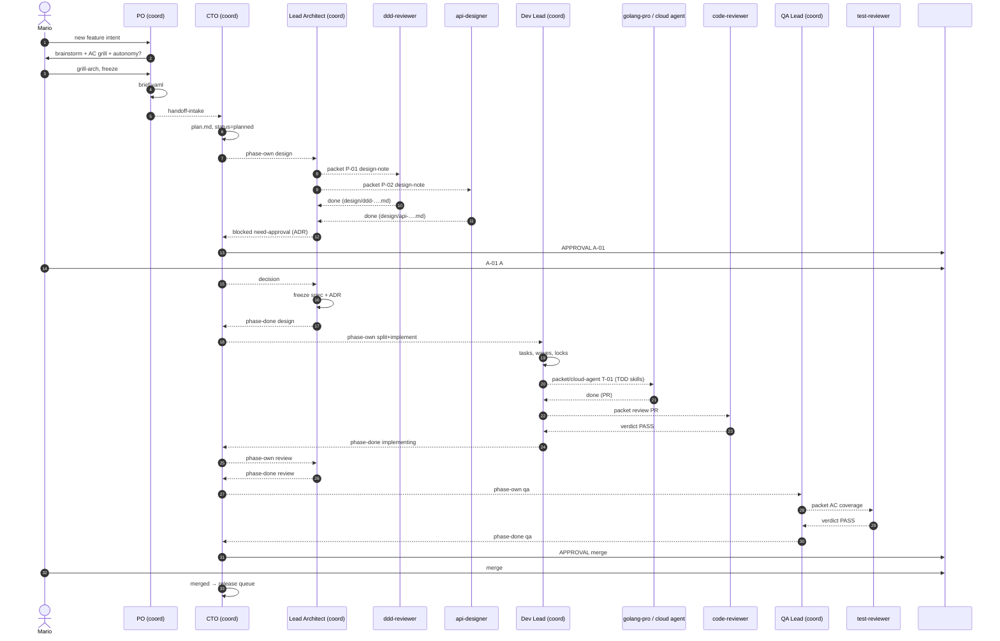
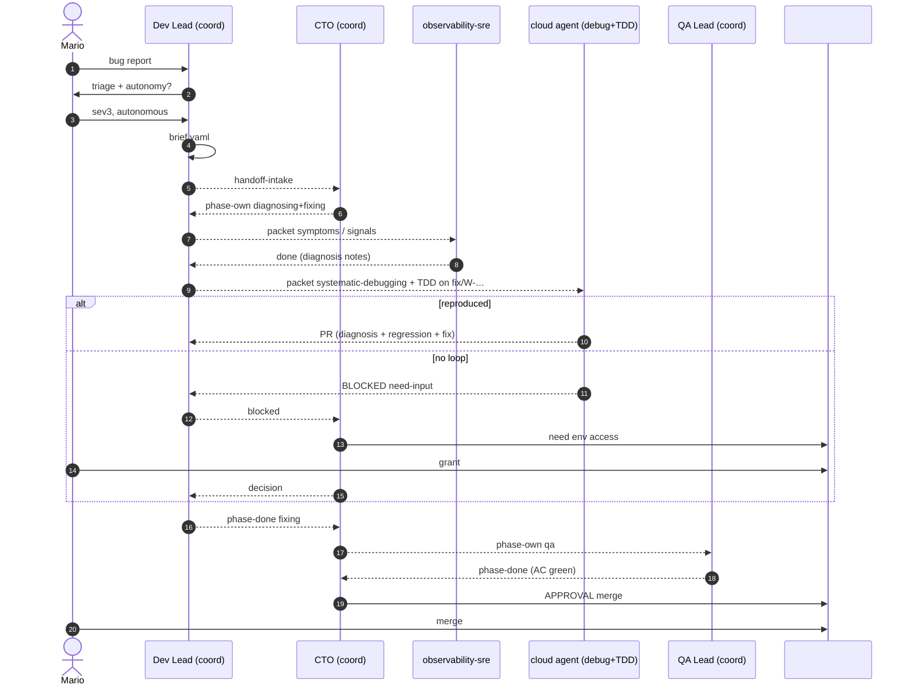

# TEOS Minion Collaboration Design (v2)

Date: 2026-10-21. Inputs: Mario's coordinator/packet decisions; `report_teos.md`, `report_standalone_agents.md`, `report_sdd_systems.md`, `report_web.md`. Skills listed in `skills_inventory.md`.

## 0. Core principles

1. **Phase logic lives only in coordinators** (CTO, and PO / Dev Lead / Lead Architect / QA Lead / Platform Lead as phase owners). Coordinators decide the next phase, craft work packets, pick skills (or an allow-list), and advance state.
2. **Specialists execute one packet and stop.** They have no embedded pipeline, no "then hand to X" logic, and do not choose the next phase. They return `done` / `blocked` / `escalate` with artifacts.
3. **Artifacts are the handoff; messages are doorbells.** Content that matters lives under `/workspace/minions/work/<id>/`. Messages point at files.
4. **One owner per state** in `status.json`. Only that owner may write status; only a coordinator may change `owner`.
5. **Skills are a shared global library** (Grok Bot). Coordinators name the skills for a packet, or the specialist picks from its allow-list. Skills are process/domain capabilities, not workflows.
6. **Code only via Cursor cloud agents → PRs.** No minion pushes to `main`. Merge and release follow autonomy / always-gates.
7. **One approval inbox:** `#teos-approvals` (Mario + coordinators). Only the CTO posts approval requests there.
8. **Full team from day one.** Specialists exist as bots; they are idle until a coordinator sends a packet.

Borrowed (not as backbone): Superpowers brainstorm→plan→TDD→review; Spec Kit clarify + converge; OpenSpec living deltas; BMAD correct-course; EARS acceptance criteria; MetaGPT artifact SOPs.

## 1. Autonomy levels

Set at intake in `brief.yaml`. Change mid-flight only by Mario (`/autonomy <id> <level>`).

| Level | Name | Mario approves | Bots decide alone |
|---|---|---|---|
| **L0** | `pair` | Every decision packet that asks a question; every ADR; every freeze; merge; release | Drafting only |
| **L1** | `grill-design` | Spec freeze; architecture (L2 gates); **plus** design: public APIs/OpenAPI, event schemas, DynamoDB access patterns, UI flows, F-spec freeze | Task split, implementation, review fix-loops |
| **L2** | `grill-arch` | Spec freeze; bounded contexts / aggregates / new services; new AWS resources or data stores; cross-service contracts; all ADRs; new ubiquitous-language terms; security/tenancy-impacting changes; merge; release | Detailed design, task split, impl, review fix-loops |
| **L3** | `autonomous` | Always-gates + final merge | Everything else; recommended options logged in `decisions.md` |
| **L4** | `autonomous-merge` | Always-gates only | Merge to `main` when gates green (never release/deploy) |

Use **names** in chat. Freedom order: `pair` < `grill-design` < `grill-arch` < `autonomous` < `autonomous-merge`.

**Always-gates (any level):** production deploy / release tag / customer provision; irreversible data migrations or DynamoDB key-schema changes; IAM/Cognito/OPA loosening or tenant-isolation changes; budget breach (default >12 cloud-agent runs or >3 fix-loop rounds); scope change vs frozen brief; accepting degraded / unreachable review.

**Defaults**

| Type | Intake coordinator | Default level |
|---|---|---|
| User-facing feature | PO | `grill-arch` (new service/BC → `grill-design`) |
| Bug sev3/4 | Dev Lead | `autonomous` |
| Incident sev1/2 | Dev Lead | `autonomous` for diagnosis; always-gate for prod action |
| Internal (obs, refactor, debt, deps) | Dev Lead | `autonomous` (layer-moving refactor → `grill-arch`) |
| Spike | either | `autonomous` (doc only) |

## 2. Intake paths and brief

```
User-facing feature → PO chat (brainstorm + brief) ─┐
Bug / internal / incident → Dev Lead chat (triage)  ─┼→ brief.yaml frozen → CTO
Ad-hoc to CTO → CTO classifies → PO or Dev Lead      ┘
```

PO / Dev Lead are **intake coordinators**: they grill Mario, freeze the brief, then hand to the CTO. They do not run the full delivery pipeline unless the CTO assigns them a later phase.

### 2.1 `brief.yaml`

```yaml
id: W-2026-0042
title: "Alarm snooze per building"
type: feature                 # feature | bug | incident | internal | spike
subtype: user-facing
autonomy:
  level: grill-arch           # pair | grill-design | grill-arch | autonomous | autonomous-merge
  extra_gates: []             # e.g. ui-review, perf-bench, api-contract
  budget: { cloud_agent_runs: 12, wall_days: 5 }
priority: P2
severity: null                # sev1..sev4 for bugs/incidents
requested_by: mario
intake_owner: po              # po | devlead
problem: |
  Facility managers get alarm floods during maintenance windows…
acceptance_criteria:          # EARS-style; become tests
  - id: AC1
    when: "a building is in maintenance mode AND an alarm triggers"
    shall: "store the alarm as snoozed AND send no notification"
scope:
  in: ["go-services/core/management/alarm-service", "web/teos alarm view"]
  out: ["tklocal", "providers"]
  services: [alarm-service]
  repos: [teos]
risk:
  level: medium               # low | medium | high
  areas: [tenancy, data-migration, api-contract, iac, cost, perf, security]
links: { prd: null, issue: null, incident: null, diagnose: null }
deadline: null
created: 2026-10-21T12:00:00+02:00
frozen: true
```

CTO rejects incomplete briefs (`blocked: brief-invalid`).

## 3. Coordinator-owned phase machine

Coordinators own phases. Each phase ends when the phase coordinator marks it done (after collecting specialist `done`s) and the CTO advances `status.json`.

| State | Phase coordinator | What they do | Exit |
|---|---|---|---|
| `intake` | PO or Dev Lead | Grill Mario; write brief | brief frozen |
| `planned` | CTO | Validate brief; write `plan.md` (phases, packets, skill hints, gates); assign locks | plan ready |
| `spec` | Lead Architect (or PO for pure product) | Packet specialists for domain/API/event/UI design notes; assemble draft spec | draft spec + design notes |
| `design` | Lead Architect | Packet ADRs, grill questions per autonomy; freeze design/spec | frozen spec + ADRs + decisions |
| `split` | Dev Lead | Decompose into tasks (layers/boundaries/owns); write waves + path locks | `_index.md` + `T-NN` + `waves.json` |
| `implementing` | Dev Lead | Packet implementers / launch cloud agents per task; TDD; fix-loops | feature branch + task PRs |
| `review` | Lead Architect + QA Lead | Packet reviewers (code, arch, security, adversarial); collect verdicts | review PASS / escalate |
| `qa` | QA Lead | Packet test-designer/reviewer; AC map; converge spec-vs-impl | all ACs green |
| `ready-to-merge` | CTO | Autonomy gate → `#teos-approvals` or L4 merge | merge approved |
| `releasing` | Platform Lead (+ Release Config Mgr) | Notes, versions, locks, deploy plan; always-gate | tagged / deployed |
| `done` | CTO | Archive after 14 days | — |

Side states: `awaiting-approval`, `blocked`, `cancelled`, `correct-course` (spec invalidated mid-impl → Lead Architect + PO).

Bug short path: `intake → planned → diagnosing → fixing → review → qa → ready-to-merge → merged → (hotfix-release) → done`.

## 4. Work packets

A packet is the unit a specialist receives. Coordinators write them; specialists never invent the next packet.

### 4.1 Packet schema (`packets/P-NN-<slug>.yaml`)

```yaml
id: P-03
work: W-2026-0042
phase: design
from: lead-architect
to: ddd-reviewer
type: design-note            # design-note | review | implement | diagnose | write | consult
objective: |
  Propose aggregate boundaries for alarm snooze given brief AC1–AC3.
inputs:
  - /workspace/minions/work/W-2026-0042/brief.yaml
  - teos/.../alarm-service/...
skills:                      # coordinator-chosen; specialist may subset from allow-list
  preferred: [brainstorming, writing-plans]
  allow: [brainstorming, writing-plans, using-superpowers]
constraints:
  - "No code. Design Note ≤500 words."
  - "Use UBIQUITOUS terms; mark inferred if missing."
  - "Autonomy grill-arch: do NOT freeze; return options for ADRs."
deliverables:
  - path: design/ddd-alarm-snooze.md
    format: design-note      # design-note | verdict | code-pr | doc | diagnosis
deadline_at: 2026-10-21T16:00:00+02:00
reply_with: [done, blocked, escalate]
```

**Rules for specialists:** read packet → run only listed/allow-listed skills → write deliverables → reply once with `done`/`blocked`/`escalate`. Do not message other specialists. Do not advance phase. Do not invent follow-up work.

**Coordinator after `done`:** validate artifact, log decision if needed, either send another packet in the same phase or tell CTO the phase is complete.

## 5. Full team roster

### 5.1 Coordinators

| Role | Bot id | reports_to | receives packets from | produces | default skills | escalate_when |
|---|---|---|---|---|---|---|
| **CTO** | `cto` | Mario | Mario, all coordinators (`done`/`blocked`) | `plan.md`, routing, approvals posts, watchdog, digest, merge gate | writing-plans, executing-plans, dispatching-parallel-agents, verification-before-completion, requesting-code-review, finishing-a-development-branch, using-superpowers | Always-gates; cross-coordinator conflict; budget; owner-unresponsive |
| **PO** | `po` | CTO | Mario (features); CTO (correct-course, product questions) | brief (features), PRD-ish problem/AC, acceptance sign-off, KPI asks | brainstorming, writing-plans, requesting-code-review, google-drive, using-superpowers | Scope change; new personas/markets; freeze at L0–L2 |
| **Dev Lead** | `devlead` | CTO | Mario (bugs/internal); CTO (split/implement phases) | triage briefs, task split, waves, cloud-agent launches, restack | writing-plans, executing-plans, subagent-driven-development, dispatching-parallel-agents, test-driven-development, systematic-debugging, verification-before-completion, finishing-a-development-branch, using-git-worktrees, using-superpowers | MERGE-CANDIDATE conflicts; ceiling exceeded; lock conflicts; cloud-agent ESCALATION |
| **Lead Architect** | `architect` | CTO | CTO (spec/design/review phases) | draft+frozen specs, ADRs, design packets, arch review synthesis | brainstorming, writing-plans, verification-before-completion, requesting-code-review, receiving-code-review, aws-architecture-diagram, aws-well-architected-review, using-superpowers | Irreversible arch; ADR needed; BC split; constitution violation |
| **QA Lead** | `qa` | CTO | CTO (qa/review phases) | AC↔test map, EC coverage, converge GO/NO-GO, CI labels | verification-before-completion, test-driven-development, requesting-code-review, receiving-code-review, using-superpowers | AC untestable; flake ceiling; missing coverage vs AC |
| **Platform Lead** | `platform` | CTO | CTO (release/iac/ops); Dev Lead (iac tasks) | deploy plans, CDK/IaC packets, env access, release coordination | aws-serverless-deployment, aws-cdk, aws-cloudformation, aws-deployment, aws-observability, aws-security, aws-billing-and-cost-management, docker-*, verification-before-completion, using-superpowers | Prod deploy; cost anomaly; lockfile / module sync |

### 5.2 Specialists

| Role | Bot id | reports_to | receives from | produces | escalate_when |
|---|---|---|---|---|---|
| **golang-pro** | `golang` | Dev Lead | Dev Lead (implement packets); cloud-agent prompts | Go code + tests + change summary / PR | verify-failed after 2 fix rounds; architecture question |
| **typescript-frontend** | `frontend` | Dev Lead | Dev Lead | TS/React UI + Vitest | design undecided; a11y/security concern |
| **provider-integration** | `provider` | Dev Lead | Dev Lead / PO (vendor needs) | provider adapters + e2e vendor tests | vendor API ambiguity; tenancy |
| **edge-tklocal** | `edge` | Dev Lead | Dev Lead | on-prem agent / MQTT / WebUI changes | field-device risk; offline semantics |
| **analytics-cep** | `analytics` | Dev Lead | Dev Lead / Architect | cbanalytics monitors/plans/runtime | CEP plan cost; correctness risk |
| **test-designer** | `test-design` | QA Lead | QA Lead / Dev Lead | test plans; failing tests (red) | AC ambiguous |
| **test-reviewer** | `test-review` | QA Lead | QA Lead | `== Verdict ==` on tests vs ACs | coverage gate fail |
| **adversarial-reviewer** | `adversarial` | QA Lead & Architect | QA Lead / Architect | red-team verdict; ≤3 ADR candidates | approach fundamentally flawed |
| **code-reviewer** | `code-review` | Dev Lead | Dev Lead / Architect | quality verdict; defers to specialists | Critical security/arch finding |
| **security-auditor** | `sec-audit` | Architect (dotted CTO) | Architect / Platform | security verdict | tenancy/IAM loosening |
| **security-policy-architect** | `sec-policy` | Architect | Architect | OPA/Rego, Cognito, NIST mappings | policy loosening; new trust boundary |
| **clean-arch-reviewer** | `clean-arch` | Architect | Architect | layering verdict (BLOCKER triggers) | domain depends on infra |
| **hexagonal-reviewer** | `hex` | Architect | Architect | ports/adapters verdict | boundary violation |
| **ddd-reviewer** | `ddd` | Architect | Architect | BC/aggregate design note or verdict | BC split / shared kernel risk |
| **event-architect** | `events` | Architect | Architect | event catalogue/schemas / evolution | breaking event change |
| **api-designer** | `api` | Architect | Architect | OpenAPI/AsyncAPI drafts or contract verdict | breaking public API |
| **ui-designer** | `ui` | Architect / PO | Architect / PO | UI specs, tokens, DaisyUI patterns | brand/a11y undecided |
| **ux-designer** | `ux` | PO | PO / Architect | flows, personas, usability notes | conflicting personas |
| **aws-serverless-cdk** | `aws-cdk` | Platform / Architect | Platform / Architect / Dev Lead | CDK design/impl notes; stack PRs via cloud agent | new AWS resource (L2 gate) |
| **dynamodb-dsql** | `data` | Platform / Architect | Platform / Architect | access-pattern design; key schema | key-schema change (always-gate) |
| **observability-sre** | `obs` | Platform | Platform / Dev Lead | instrumentation plan; incident diagnosis support | sev1/2; missing SLOs |
| **cost-auditor** | `cost` | Platform | Platform / Architect | cost findings + savings (Awspricing MCP) | budget breach |
| **resilience-auditor** | `resilience` | Platform | Platform / Architect | timeout/CB/bulkhead verdict | retry storms / SLO risk |
| **kpi-architect** | `kpi` | PO | PO / Architect | KPI table (formula, event, threshold, dashboard) | SLA commitment |
| **release-config-mgr** | `release` | Platform Lead | Platform Lead | versions, `.cbrepo-locks`, CHANGELOG, cascade-merge | lock conflict; Dependabot vs locks |
| **technical-writer** | `writer` | CTO (shared) | any coordinator | AsciiDoc/Markdown docs; corpus bootstrap | branding/legal |
| **customer-onboarding** | `onboard` | Platform / PO | PO / Platform | provision-config, customer product wiring | customer provision (always-gate) |

UX and UI may be one bot (`ux-ui`) early on; keep both ids in roster with the same chat if merged.

## 6. Skill → role mapping

Full inventory with descriptions: `skills_inventory.md`. Summary of **preferred** skills (coordinators may still attach any skill; specialists may only run their allow-list).

| Skill family | Preferred roles |
|---|---|
| Superpowers process (`brainstorming`, `writing-plans`, `executing-plans`, `subagent-driven-development`, `dispatching-parallel-agents`, `test-driven-development`, `systematic-debugging`, `verification-before-completion`, `requesting-code-review`, `receiving-code-review`, `finishing-a-development-branch`, `using-git-worktrees`, `writing-skills`, `using-superpowers`) | Coordinators (all process); implementers get TDD / worktrees / finishing-branch; reviewers get requesting/receiving-code-review + verification |
| AWS core (serverless, lambda, api-gw, step-fn, cdk, cfn, database, messaging, observability, security, iam, auth, secrets, billing, well-architected, networking, storage, deployment, compute, containers, bedrock, ai-ml, sdk-js, signing-in, launch-with-aws, architecture-diagram, deploy, elastic-beanstalk) | `aws-cdk`, `data`, `obs`, `sec-audit`, `sec-policy`, `platform`, `architect`, `cost`, `resilience`; `frontend` for sdk-js; `golang` rarely (Go SDK, not js) |
| AWS AgentCore (`agents-*`) | Platform / Architect when building agent runtimes; otherwise unused for teos app work |
| AWS data analytics (OpenSearch, Redshift, data-lake, MWAA, vectors) | `analytics`, `data`, Platform as needed |
| Docker (`docker-*`) | Platform, `edge`, implementers when containers involved |
| `impeccable` | `ui`, `ux`, `frontend` |
| `google-drive` | PO, writer, CTO (docs intake) |

**MCP connectors** (not skills; attach per bot): Gmail, Google Drive, Awsknowledge, Awsiac, Awspricing, Aws-mcp, Aws-serverless-mcp, Origin. GitHub MCP after auth — prefer cloud agents for PRs until connected.

Allow-lists per specialist are the rows in §5.2 skills column of `skills_inventory.md` §3. Coordinators get all Superpowers process skills + domain skills matching their phase.

## 7. Shared folder layout

```
/workspace/minions/
├── README.md
├── roster.yaml                 # bot id → role, chat, allow-list, backup, mcp
├── registry/
│   ├── counter
│   ├── index.jsonl
│   ├── locks.json              # path-glob locks + worktree/branch
│   └── budget.json
├── inbox/<bot>/msg-<ulid>.json
├── work/<id>/
│   ├── brief.yaml
│   ├── status.json
│   ├── plan.md
│   ├── log.jsonl
│   ├── decisions.md
│   ├── approvals/A-NN-*.md(+.answer.md)
│   ├── packets/P-NN-*.yaml     # coordinator-written work packets
│   ├── spec/                   # draft + frozen specs, AC list
│   ├── design/                 # design notes from specialists
│   ├── tasks/_index.md, T-NN-*.md, waves.json
│   ├── impl/T-NN/agent.json    # cloud agent id, branch, PR, runs
│   ├── review/*.verdict.md
│   ├── qa/acceptance.md        # AC id → test → result; converge report
│   ├── release/
│   └── retro.md
└── archive/<YYYY>/<id>/
```

Specs and code live in the **teos repo**; the minion folder holds coordination state + copies/pointers (repo wins; folder stores paths + SHAs).

### 7.1 `status.json`

```json
{
  "id": "W-2026-0042",
  "state": "design",
  "owner": "architect",
  "open_packets": ["P-03", "P-04"],
  "phase_started": "2026-10-21T13:02:00+02:00",
  "deadline_at": "2026-10-22T13:02:00+02:00",
  "waiting_on": null,
  "attempt": 1,
  "last_msg": "msg-01JB...",
  "blocked_reason": null,
  "version": 7
}
```

Atomic write: temp + `mv`. Prefer `flock` on `status.json.lock`. Optimistic `version` check.

## 8. Message protocol

### 8.1 Envelope

First line of chat + durable JSON in `inbox/<to>/`:

```
⟦MINION v1 | id=msg-… | w=W-… | type=packet | from=architect | to=ddd | re=- | hop=1 | ttl=8h | state=design | packet=P-03⟧
Packet: /workspace/minions/work/W-2026-0042/packets/P-03-ddd-boundaries.yaml
```

### 8.2 Types

| Type | Who → whom | Reply |
|---|---|---|
| `packet` | coordinator → specialist | `ack` ≤15 min, then `done`/`blocked`/`escalate` |
| `ack` | specialist → coordinator | none |
| `progress` | specialist → coordinator (≤1 / 2 h) | none |
| `done` | specialist → coordinator | none (coordinator continues) |
| `blocked` | specialist → coordinator | coordinator acts |
| `escalate` | coordinator → CTO → `#teos-approvals` | Mario / CTO decision |
| `decision` | CTO → waiting coordinator | `ack` |
| `phase-done` | phase coordinator → CTO | CTO advances |
| `handoff-intake` | PO/Dev Lead → CTO | CTO plans |
| `cancel` / `ping` | CTO → owner | `ack` / status |

Blocked codes: `need-input, need-approval, dependency, conflict, verify-failed, reviewer-blocked, ceiling-exceeded, budget-exceeded, infra, unclear-brief, owner-unresponsive, loop, stale`.

### 8.3 Loop / stall rules

- Star topology for phase ownership via CTO; specialists only talk to the coordinator who sent the packet.
- `hop` limit 4 → `blocked: loop`.
- Ignore duplicate `id`s and state-mismatched messages (`ack:stale`).
- No replies to `ack`/`progress`/`done` except state changes.
- Fix-loop ceiling: 3 review→fix rounds per PR, 2 design redrafts, then escalate.
- Watchdog (CTO, every 30 min 08–22 Stockholm, every 2 h night): re-send unacked packets once; reassign via `roster.backup` after 1 h; ping silent owners; check cloud-agent `agent.json`; release stale locks; write `registry/watchdog.log`. PO daily checks watchdog freshness.

## 9. Approvals

`#teos-approvals` group: Mario + all coordinators. **Only CTO posts.**

```
🔶 APPROVAL A-01 · W-2026-0042 · gate=adr · level=grill-arch · blocks: design
Q: Snooze on Alarm aggregate (A) or MaintenanceWindow in buildingsvc (B)?
A. (Recommended) MaintenanceWindow; alarm-service consumes event.
B. Attribute on Alarm; faster, couples domains.
Details: …/approvals/A-01-adr.md
Reply: "A-01 A" | "A-01 B" | "A-01 discuss"
```

Interactive grills (intake, design at `pair`/`grill-design`) stay in the phase coordinator's private chat; CTO posts a pointer. Batch non-urgent ≤2 posts/day; P0/P1 immediate.

## 10. Cloud coding agents

- **Only Dev Lead** launches cloud agents for application code. Platform/Release may launch version-bump / IaC PRs; writer for doc-only PRs.
- One agent per `T-NN`. Prompt includes packet path, skills to use (`test-driven-development`, `verification-before-completion`, `finishing-a-development-branch`, …), base branch, "open PR into feat/…; no merge; no closing keywords; on BLOCKED write decision into PR body".
- ≤4 parallel agents per feature, ≤6 team-wide. Budget in `registry/budget.json`.
- Dev Lead parses PR bodies for `ESCALATION:` / `Needs-human` and turns them into `blocked` toward CTO.
- Implementer bots (`golang`, `frontend`, …) may also be asked to draft patches on the shared box via worktrees for small tasks; production path is still cloud agent → PR.

## 11. Branches, worktrees, locks

- `prd/PRD-…`, `feat/F-…` or `feat/W-…`, `task/…/T-NN-…`, `fix/W-…`, `hotfix/W-…`, `chore/W-…`
- Local worktrees: `teos/work/git-worktree/<W-id>-<slug>` — one per work item, for box-side tooling only.
- On `split`, Dev Lead unions task Owns into `locks.json`. Overlap → queue `blocked: conflict`.
- Global serial hot spots: `go-core/**` interfaces, `meta/spec/**`, `.cbrepo-locks.json`, `deployment/lib/**`, `go.work`, `Makefile`.
- Restack is Dev Lead's job across features.

## 12. Review / QA gates

| Gate | Coordinator | Specialists packeted | Human? |
|---|---|---|---|
| Spec/design | Architect | ddd, api, events, aws-cdk, data, sec-policy, ui/ux as needed | per autonomy |
| ADR / freeze | Architect → CTO | — | per autonomy; always for ADRs at L0–L2 |
| Task PR | Dev Lead | code-review (+ clean-arch/hex/ddd/security by character); test-review | no (ceiling → escalate) |
| Feature review | Architect + QA | adversarial, code-review, contract-ish via api, security if risk | Critical/High & ADR: per level |
| Converge (spec vs impl) | QA | test-reviewer + adversarial | NO-GO → correct-course |
| AC acceptance | QA | test-designer / test-reviewer | no |
| Security / tenancy | Architect | sec-audit, sec-policy | loosening = always-gate |
| Merge | CTO | — | L0–L3 Mario; L4 bot |
| Release / deploy | Platform | release-config-mgr, cost, obs | always-gate |

Author of a phase never reviews it. No AWS tests in CI today → items with `risk.areas ∋ iac` get a Platform-run svctest before merge when possible; keep `autonomous-merge` rare until that exists.

## 13. Bug & incident flow

- **Bug:** Mario → Dev Lead intake → brief (`type:bug`, AC = regression) → CTO plans short path → Dev Lead packets `obs` (if needed) + cloud agent with `systematic-debugging` + `test-driven-development` → QA AC check → merge gate.
- **Incident:** Dev Lead opens brief immediately; CTO posts to `#teos-approvals`; parallel diagnose (`obs`, `systematic-debugging`) and mitigation options. Any prod action = always-gate. Afterward: `retro.md` + follow-up `internal` items.
- No reproducible loop → `blocked: need-input`, never guess-and-patch.

## 14. Release flow

1. CTO queues `merged` items → Platform Lead.
2. `release-config-mgr`: notes, CHANGELOG, versions, `.cbrepo-locks`, cascade-merge check.
3. QA smoke / svctest on RC.
4. CTO posts always-gate release approval.
5. On approve: tag + `cbdeploy`; customer provision separate always-gate.
6. `done` → archive 14 days. Hotfix from tag; back-merge by Release.

## 15. Correct-course & living specs

If implementation invalidates the frozen spec: Dev Lead → `blocked: conflict` → CTO sets `correct-course` → Architect + PO revise spec (delta file under `spec/`) → re-split affected tasks. After ship, Architect packets `writer` / themselves to merge deltas into the bounded-context living spec (OpenSpec-style) so the next brief starts from truth.

## 16. Persona contract (every bot)

```
## Team protocol (mandatory)
- Read /workspace/minions/README.md and roster.yaml.
- Act only on ⟦MINION v1⟧ messages or Mario. Dedupe via log.jsonl.
- Specialists: execute one packet; reply done/blocked/escalate; never choose next phase; never message other specialists.
- Coordinators: own phase logic; write packets; only CTO changes owner / posts #teos-approvals / merges (L4).
- Write status.json only if you are owner. Use flock + version.
- Never merge/deploy unless CTO under L4 merge or Platform under approved release.
```

Reviewers/auditors: read-only tools (Read/Grep/Glob/Bash). Implementers/writers: Write/Edit. Output: Design Note ≤500 words **or** `== Verdict ==` (Verdict, Findings `[sev] file:line`, Rationale). No-corpus mode: infer names, mark `inferred`, do not fail on missing UBIQUITOUS/DDD/ARCHITECTURE.

## 17. Diagrams

### 17.1 Feature flow (`grill-arch`)



### 17.2 Bug flow (`autonomous`)



## 18. Tradeoffs

- **Coordinator bottleneck:** all phase logic funnels through a few bots. Mitigate with clear backups in `roster.yaml` and durable folders so any coordinator can reconstruct state.
- **Specialists are "dumb" by design:** no local initiative means more packets and more coordinator turns, but eliminates phase-skipping and peer loops.
- **Full team cost:** many idle bots; justified so packets never wait on "missing role". Keep specialists cheap/fast models; coordinators and adversarial/security on stronger models.
- **Async FS:** no true distributed lock; flock + single-writer + version are mandatory discipline.
- **Skills sprawl:** AWS inventory is large; allow-lists and packet `skills.preferred` keep context small.
- **L4 unsafe until AWS svctest is routine.**
- **Cloud-agent escalations as PR text** require Dev Lead parsing — brittle; prefer a sidecar `impl/T-NN/result.json` convention in the agent prompt.

## 19. Bootstrap order (full team, no pilot)

1. Create `/workspace/minions/` skeleton + `roster.yaml` + README excerpt of this doc.
2. Stand up coordinators (CTO, PO, Dev Lead, Architect, QA, Platform) with persona tails from §16.
3. Stand up all specialists with allow-lists from `skills_inventory.md`; attach AWS MCPs to Platform/Architect/aws-cdk/data/obs/cost/sec-*.
4. Wire `#teos-approvals` and CTO watchdog/digest routines.
5. Smoke: one `internal` packet path and one small `feature` path end-to-end, then open the floodgates.
